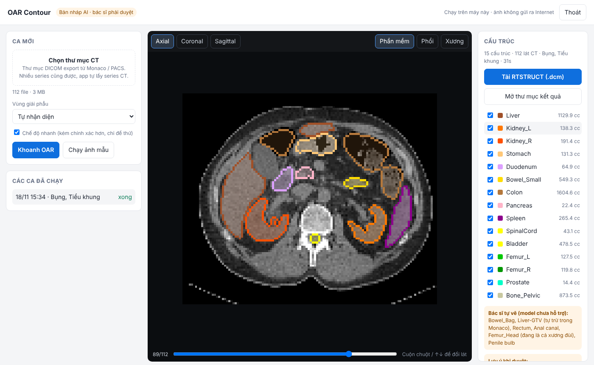

# Hướng dẫn chạy trên MacBook

Áp dụng cho MacBook chip Apple (M1–M4) hoặc chip Intel, macOS 12 trở lên.
Model chạy bằng CPU của Mac. Ảnh CT mẫu mất khoảng 1–3 phút, ca thật 5–20 phút tuỳ vùng.

## 1. Cài công cụ (làm 1 lần, khoảng 15 phút)

Mở **Terminal** (Cmd + Space, gõ "Terminal"), dán **nguyên khối** dưới đây rồi Enter.
Không cần cài Python trước: công cụ `uv` tự cài Python 3.12, không cần mật khẩu máy.

```bash
cd ~
git clone https://github.com/PhanquanUngbuou/OARcontouring.git
curl -LsSf https://astral.sh/uv/install.sh | sh
source $HOME/.local/bin/env
cd ~/OARcontouring
uv venv --python 3.12
source .venv/bin/activate
uv pip install -e ".[model]"
```

- Nếu `git clone` báo đã có thư mục `OARcontouring` thì bỏ qua, chạy tiếp các dòng sau.
- Nếu Mac hỏi cài "command line developer tools" khi chạy `git`, bấm **Install** rồi chạy lại khối lệnh.
- Bước `uv pip install` tải khoảng 1–2 GB (PyTorch), cần mạng ổn định.

**Mỗi lần mở Terminal mới** để dùng công cụ, chạy trước:

```bash
cd ~/OARcontouring && source .venv/bin/activate
```

## 2. Tạo app "QuanContour" (làm 1 lần)

```bash
cd ~/OARcontouring && git pull && source .venv/bin/activate && uv pip install -e ".[model]"
bash scripts/tao_app_mac.sh
```

Finder sẽ mở ra chỗ có **QuanContour.app**. Kéo nó vào **Dock** cho tiện.
Từ giờ **không cần Terminal nữa**.

## 3. Dùng app hằng ngày



1. Bấm **QuanContour** trên Dock. Trình duyệt tự mở giao diện (lần đầu chờ vài giây).
2. Bấm **Chọn thư mục CT** → chọn thư mục DICOM export từ Monaco/PACS.
   Thư mục có nhiều series cũng được, app tự lấy series CT nhiều lát nhất.
3. Chọn **Vùng giải phẫu** (hoặc để Tự nhận diện) → bấm **Khoanh OAR**.
4. Chờ xong (Mac chạy CPU: khoảng 2–15 phút tuỳ vùng). Có thể làm việc khác trong lúc chờ.
5. Xem kết quả:
   - **Cuộn chuột** hoặc phím ↑↓ để đổi lát; nút **Axial / Coronal / Sagittal** để đổi mặt cắt.
   - **Phần mềm / Phổi / Xương**: đổi cửa sổ hiển thị.
   - **Bấm tên cơ quan** để nhảy tới lát giữa cơ quan đó; bỏ tích để ẩn.
6. **Tải RTSTRUCT (.dcm)** để đưa vào Monaco (cùng bộ CT gốc), hoặc **Mở thư mục kết quả**.
7. Xong việc bấm **Thoát** (góc trên phải).

- **Chạy ảnh mẫu**: thử app với ảnh CT công khai, không cần dữ liệu bệnh nhân.
- Mọi ca được lưu trong thư mục `~/OAR_ketqua` và hiện ở mục "Các ca đã chạy" để mở lại.

## Sửa contour ngay trong app (và lưu làm dữ liệu huấn luyện)

1. Mở một ca đã khoanh xong. Bấm **tên cấu trúc** ở cột phải để chọn cấu trúc cần sửa.
2. Thanh công cụ dưới ảnh: **Xem** (kéo để di chuyển) · **✎ Vẽ thêm** · **⌫ Tẩy** · **Cỡ bút** (mm).
   - Vẽ thêm một **vòng kín** thì phần bên trong tự được tô kín.
   - Sửa được trên Axial, Coronal, Sagittal. **↶ Hoàn tác** (Ctrl/⌘+Z).
   - Phím tắt: V (xem), B (vẽ), E (tẩy), [ và ] (đổi cỡ bút).
3. Cơ quan app chưa vẽ được (Brainstem, OpticChiasm…): bấm **+ Thêm cấu trúc**, đặt tên không dấu, rồi vẽ.
4. Sửa xong bấm **Lưu bản đã duyệt**:
   - **Tải RTSTRUCT (bản đã duyệt)** để đưa vào Monaco (vẫn tải được bản tự động gốc nếu cần);
   - ca được lưu vào **kho dữ liệu huấn luyện** trên máy này, kèm bảng mỗi cơ quan khớp bao nhiêu % với bản tự động;
   - màn hình "Ca mới" có thẻ **Kho dữ liệu huấn luyện**: số ca đã duyệt, cơ quan nào phải sửa nhiều nhất.

Khi kho đủ khoảng 50–100 ca mỗi vùng, các ca này dùng để huấn luyện model của khoa.

## 4. (Tuỳ chọn) Chạy bằng dòng lệnh

1. Từ Monaco hoặc PACS, export **1 series CT mô phỏng** (DICOM) vào một thư mục, ví dụ
   `~/OAR_test/ca01/ct`. Nên dùng ca cũ đã ẩn danh. Thư mục chỉ chứa đúng 1 series.
2. Chạy (đổi `--site`: `thorax`, `abdomen`, `pelvis`, `headneck`, hoặc bỏ đi để tự nhận diện):

```bash
cd ~/OARcontouring && source .venv/bin/activate
oar-contour run ~/OAR_test/ca01/ct --site thorax \
  -o ~/OAR_test/ca01/RS_AI.dcm --preview ~/OAR_test/ca01/preview.png
open ~/OAR_test/ca01/preview.png
```

## 5. (Tuỳ chọn) Xem 3D bằng 3D Slicer (miễn phí)

App đã xem được từng lát. Slicer chỉ cần khi muốn xem 3D hoặc chỉnh contour:

1. Tải **3D Slicer** bản Stable tại https://download.slicer.org (chọn macOS), kéo vào Applications.
   Lần đầu mở nếu macOS chặn: chuột phải vào Slicer → Open.
2. Trong Slicer: **View → Extensions Manager** → tìm **SlicerRT** → Install → khởi động lại Slicer.
3. Kéo **cả thư mục ca** (gồm `ct/` và `RS_AI.dcm`) vào cửa sổ Slicer → chọn
   "Load directory into DICOM database" → OK.
4. Mở **DICOM** (biểu tượng trên thanh công cụ) → chọn bệnh nhân → tích cả CT và RTSTRUCT → **Load**.
5. Contour hiện màu trên 3 mặt cắt. Cuộn chuột để chuyển lát. Mở module **Data** để bật/tắt từng
   cơ quan. Bấm biểu tượng mắt ở dòng segmentation, chọn "Show 3D" để xem 3D.

## 6. Cập nhật bản mới

```bash
cd ~/OARcontouring && git pull && source .venv/bin/activate && uv pip install -e ".[model]"
```

App trên Dock tự dùng bản mới, không cần tạo lại.

## Lỗi thường gặp

| Lỗi | Cách xử lý |
|---|---|
| Bấm app không thấy gì | Chờ 5–10 giây. Vẫn không có thì mở Safari, vào `http://127.0.0.1:8765`. Nhật ký lỗi: `~/OAR_ketqua/app.log` |
| macOS báo không mở được app | Chuột phải vào app → Open → Open |
| `command not found: oar-contour` | Chưa kích hoạt môi trường: `cd ~/OARcontouring && source .venv/bin/activate` |
| `command not found: uv` | Chạy `source $HOME/.local/bin/env` hoặc mở lại Terminal |
| `Thư mục cần chứa đúng 1 series CT` | Thư mục export có nhiều series (CT + scout + ...). Giữ lại series CT mô phỏng |
| Chạy rất lâu, máy nóng | Bình thường khi chạy CPU. Thử `--fast`, hoặc chỉ định `--site` thay vì để tự nhận diện |
| Không tải được model | Kiểm tra mạng (một số mạng bệnh viện chặn GitHub). Thử lại bằng mạng khác |

## An toàn dữ liệu

- Ảnh CT chỉ được xử lý **trên chính máy Mac này**; công cụ không gửi ảnh đi đâu và đã tắt
  chức năng gửi thống kê của TotalSegmentator.
- Laptop có dữ liệu bệnh nhân cần đặt mật khẩu, bật **FileVault** (System Settings → Privacy & Security)
  và xoá ca sau khi thử xong.
- Contour là **bản nháp nghiên cứu**, không dùng trực tiếp cho lập kế hoạch khi chưa có bác sĩ duyệt.
