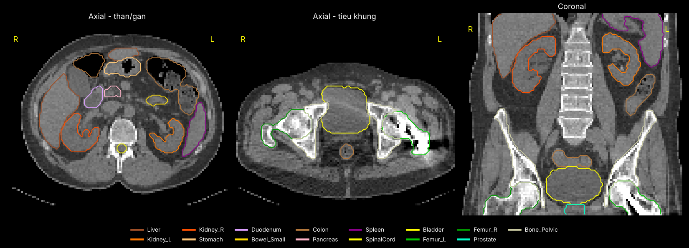
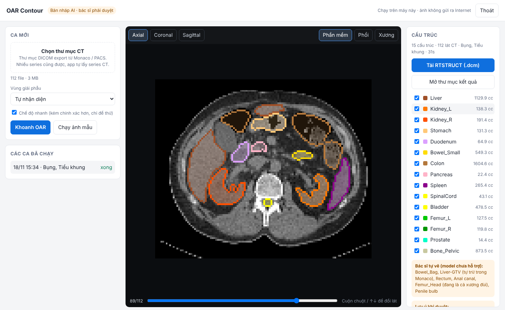

# QuanContour: tự động khoanh OAR (bản nháp) cho khoa Xạ trị

> ⚠️ **Công cụ nghiên cứu, CHƯA phải thiết bị y tế được cấp phép.** Mọi contour
> do công cụ tạo ra là **bản nháp**. Bác sĩ **bắt buộc** duyệt và sửa từng cấu
> trúc trong Monaco trước khi dùng để lập kế hoạch.

## Công cụ làm gì

```
CT-sim ──(đẩy CT như hiện nay)──────────────────────────────► Monaco
   │                                                            ▲
   └─(đẩy thêm 1 bản CT)──► máy OAR (trong mạng BV) ──RTSTRUCT──┘
                              TotalSegmentator → tên TG-263
```

1. Nhận series CT mô phỏng (DICOM) từ CT-sim.
2. Chạy model **TotalSegmentator** (mã nguồn mở, chỉ dùng các task miễn phí) để khoanh cơ quan.
3. Đổi tên theo chuẩn **TG-263** (Lung_L, SpinalCord, Parotid_R…), gộp thùy phổi, tách vú trái/phải.
4. Ghi **RTSTRUCT** gắn đúng bộ ảnh CT (cùng Frame of Reference) và gửi sang Monaco.
5. Bác sĩ mở bệnh nhân trong Monaco, thấy sẵn bộ cấu trúc `AI_OAR_DRAFT`, rồi duyệt và sửa bằng công cụ của Monaco.

Không cần giao diện vẽ riêng: bác sĩ sửa contour ngay trong Monaco như hiện nay.



*Chạy thử trên ảnh CT mẫu công khai (không phải dữ liệu bệnh nhân), CPU 4 nhân, chế độ `--fast`:
15 cấu trúc bụng + tiểu khung trong ~20 giây. Ảnh trên được dựng lại từ chính file RTSTRUCT đầu ra.*

## Vùng nào làm được, vùng nào chưa

| Vùng | Model khoanh được | Bác sĩ vẫn phải tự vẽ | Đánh giá |
|---|---|---|---|
| **Ngực / vú** (`thorax`) | Lung_L/R, Lungs, Heart, Esophagus, Trachea, SpinalCord, Breast_L/R | LAD / buồng tim, đám rối cánh tay, Bronchus | ✅ **Làm trước**: đủ gần hết OAR |
| **Bụng** (`abdomen`) | Liver, Kidney_L/R, Stomach, Duodenum, Bowel_Small, Colon, SpinalCord | Bowel_Bag | ✅ **Làm trước** |
| **Tiểu khung** (`pelvis`) | Bladder, Femur_L/R (cả xương), Bowel_Small, Colon, Bone_Pelvic | **Rectum**, ống hậu môn, Femur_Head, Bowel_Bag | 🟡 Thiếu trực tràng |
| **Đầu cổ** (`headneck`) | Brain, SpinalCord, Parotid_L/R, Glnd_Submand_L/R, Eye, Lens, OpticNrv, Bone_Mandible, Glnd_Thyroid, Esophagus | **Brainstem, OpticChiasm, Cochlea**, Larynx, cơ khít hầu, khoang miệng | 🟡 Thiếu nhiều OAR quan trọng |

**Cách dùng chính:** chọn *Mục đích* (triệt căn / triệu chứng) và *Vị trí xạ trị*: 7 vùng (U đầu cổ, U não,
U lồng ngực, U vú, U bụng – sau phúc mạc, U tiểu khung, Di căn xương), 4 kỹ thuật riêng (U não SRT/SRS,
Phổi SBRT, Gan SBRT, Cột sống SBRT) và *Trường hợp khác – tự chọn OAR*. App tự đưa ra danh sách OAR và chỉ
chạy phần xử lý cần thiết. Bảng phác đồ: [docs/PHAC_DO_OAR.md](docs/PHAC_DO_OAR.md).

Bảng trên là danh sách **mặc định** khi chọn "Tự chọn theo vùng giải phẫu". App có **231 cấu trúc** từ các model miễn phí; bác sĩ tự chọn
cho từng vùng bằng nút **Chọn cơ quan…** (lựa chọn được lưu lại). Danh sách đầy đủ:
[docs/DANH_SACH_CO_QUAN.md](docs/DANH_SACH_CO_QUAN.md). Model chỉ chạy **phần cần cho các cơ quan này** (model nhanh 6 mm để
nhận diện vùng, rồi `roi_subset` cắt ảnh quanh vùng cần), nhanh khoảng **gấp đôi** so với chạy toàn bộ
(đo trên CPU 4 nhân, ảnh mẫu bụng–chậu: 356 s → 177 s).

Xem bảng chi tiết bằng lệnh `oar-contour structures`. Với tiểu khung và đầu cổ, giai đoạn
sau có thể **tự huấn luyện model bổ sung** (nnU-Net) bằng contour cũ của khoa để vẽ các cơ quan còn thiếu.

> 🍎 **MacBook:** [HUONG_DAN_MAC.md](HUONG_DAN_MAC.md) · 🪟 **Windows (card NVIDIA):**
> [HUONG_DAN_WINDOWS.md](HUONG_DAN_WINDOWS.md) · ☁️ **Khoanh hàng loạt trên cloud GPU:**
> [HUONG_DAN_CLOUD.md](HUONG_DAN_CLOUD.md)

## App giao diện (khuyên dùng)

```bash
oar-contour app           # mở giao diện trên trình duyệt, chạy cục bộ 127.0.0.1
bash scripts/tao_app_mac.sh   # Mac: tạo "QuanContour.app" để bấm đúp
```

Chọn thư mục CT → Khoanh OAR → cuộn xem contour từng lát → tải RTSTRUCT.



## Chạy thử nhanh (không cần dữ liệu bệnh nhân)

```bash
oar-contour demo          # tải ảnh CT mẫu công khai, khoanh, xuất demo/preview.png
```

## Cài đặt (trên máy chạy trong mạng bệnh viện)

Phần cứng khuyến nghị: GPU NVIDIA ≥ 8 GB VRAM, RAM 32 GB. Chạy trên CPU vẫn được nhưng chậm
(khoảng 10–30 phút mỗi ca, tuỳ vùng).

```bash
python -m venv .venv && source .venv/bin/activate
pip install -e ".[model]"          # cài kèm TotalSegmentator + PyTorch
oar-contour structures             # kiểm tra cài đặt
```

Lần chạy đầu, TotalSegmentator tải trọng số model từ GitHub (vài trăm MB mỗi task). Sau đó máy
có thể **ngắt Internet**. Công cụ tự **tắt gửi thống kê sử dụng** của TotalSegmentator.

## Dùng thử trên 1 ca (không cần kết nối CT-sim)

```bash
oar-contour run /duong-dan/ct_series/ --site thorax -o RS_AI.dcm --preview preview.png
# Gửi luôn sang Monaco:
oar-contour run /duong-dan/ct_series/ --site thorax --send MONACO_AE@10.0.0.20:104
```

`--site auto` (mặc định) tự nhận diện vùng chụp. Thư mục đầu vào phải chứa **đúng 1 series CT**.

## Chạy tự động (DICOM node)

```bash
oar-contour serve --port 11112 --ae-title OAR_AI \
  --ae-site OAR_HN=headneck --ae-site OAR_THX=thorax \
  --send MONACO_AE@10.0.0.20:104
```

- Trên CT-sim: thêm đích DICOM thứ 2 (IP máy OAR, cổng 11112). Muốn chọn vùng cụ thể thì
  tạo nhiều đích với AE title khác nhau (`OAR_HN`, `OAR_THX`…); gọi AE khác thì node tự nhận diện vùng.
- Node coi là đã nhận đủ series khi không có lát mới trong 60 giây (`--settle`).
- Sau khi gửi xong, ảnh CT được **xoá** khỏi máy OAR (`--keep-images` để giữ lại).
  Ca lỗi được chuyển vào `oar_work/failed/` để kỹ sư kiểm tra.
- Log không chứa tên hay mã bệnh nhân; series chỉ được nhắc bằng mã băm.

### Việc cần kỹ sư vật lý / IT xác nhận với Monaco

- [ ] Monaco nhận RTSTRUCT qua DICOM (C-STORE) không, AE title / cổng nào. Có thể dùng chung đích mà CT-sim đang đẩy.
- [ ] RTSTRUCT có tự gắn vào bộ ảnh CT đã nhập không (công cụ giữ nguyên Study/Series/Frame of Reference UID của CT).
- [ ] Monaco xử lý ra sao khi RTSTRUCT về **sau** CT vài phút (tạo structure set mới hay hỏi người dùng).
- [ ] Tên cấu trúc có khớp template / protocol của khoa không. Cần đổi tên thì sửa `oar_contour/structures.py`.
- [ ] Contour External (body) để Monaco tự tạo như hiện nay; công cụ không gửi.

## Kiểm định trước khi dùng thật (bắt buộc)

Chạy trên **30–50 ca cũ mỗi vùng**, đã ẩn danh, so với contour bác sĩ đã duyệt:

```
cases/
  ca001/  ct/  ai.dcm  ref.dcm
  ca002/  ...
```

```bash
oar-contour evaluate cases/ --aliases aliases.json --csv ket_qua.csv
```

`aliases.json` đổi tên cấu trúc của khoa sang TG-263, ví dụ `{"Tuy song": "SpinalCord", "Phoi T": "Lung_L"}`.
Kết quả gồm Dice, HD95 (mm) và tỉ lệ thể tích theo từng cơ quan. Gợi ý ngưỡng chấp nhận (khoa tự quyết):
cơ quan lớn Dice ≥ 0,85; cơ quan nhỏ (thần kinh thị, thuỷ tinh thể) xem HD95 và duyệt bằng mắt.

Nên ghi thêm **thời gian bác sĩ sửa** so với vẽ tay. Đây là chỉ số thuyết phục nhất.

## An toàn & pháp lý

- **Dữ liệu bệnh nhân không rời mạng bệnh viện.** Không đưa CT lên cloud, không đưa vào RadioCare.
- Mọi cấu trúc có mô tả `AI draft - bac si phai duyet` và nằm trong structure set `AI_OAR_DRAFT`.
- Phần mềm hỗ trợ lập kế hoạch xạ trị có thể thuộc diện **trang thiết bị y tế** (Nghị định 98/2021/NĐ-CP).
  Trước khi dùng cho bệnh nhân ngoài phạm vi nghiên cứu, cần hỏi ý kiến phòng Vật tư – TTB / pháp chế
  và có quy trình được Hội đồng chuyên môn phê duyệt.
- TotalSegmentator: mã nguồn Apache-2.0; công cụ **chặn** các task cần license thương mại.
  Trích dẫn khi công bố: Wasserthal et al., *Radiology: AI* 2023.

## Cấu trúc mã

```
oar_contour/
  structures.py  bảng nhãn TotalSegmentator → TG-263, theo vùng
  segment.py     đọc CT DICOM, chạy TotalSegmentator
  pipeline.py    ghép mask, tách trái/phải, ghi RTSTRUCT
  evaluate.py    Dice / HD95 so với contour bác sĩ
  preview.py     ảnh PNG chồng contour để xem nhanh
  demo.py        chạy thử với ảnh CT mẫu công khai
  app.py, web/   app giao diện web cục bộ
  dicom_node.py  DICOM node nhận CT, gửi RTSTRUCT
  cli.py         lệnh oar-contour
tests/           test với phantom giả (không có dữ liệu bệnh nhân)
```

Chạy test: `pip install -e ".[test]" && pytest`
